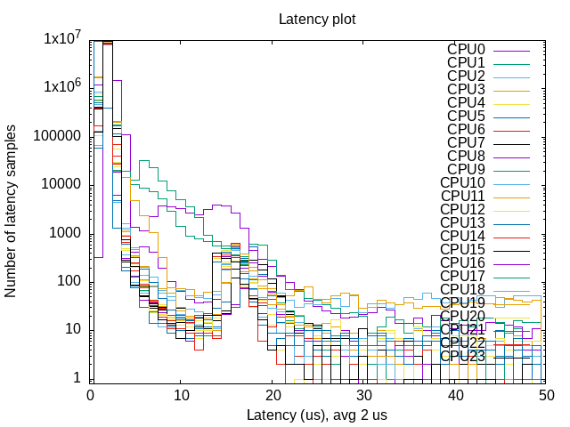

# **PREEMPT-RT**

## Short introduction to PREEMPT-RT

Preemptive Real Time (PREEMPT-RT) consists of a patched Linux kernel to make Linux real-time. PREEMPT-RT allows the developer to simply use `pthread` for real-time threads, as any other thread. The real-time behavior can be enforced by setting the thread priority to values greater than or equal to 80. Applications are developed through standard POSIX calls.

For more information check [PREEMPT-RT](https://rt.wiki.kernel.org/).

## Why you need PREEMPT-RT

The difference between an RTOS and a general purpose OS is that, with an RTOS, the response times are known.
In theory, the Robotics Lab robots require a real time communication to be active between the control box and the PC.
This is required for several reasons, such as: a real-time kernel ensures that operations, like sending commands or receiving feedback, are executed within predictable time frames; additionally, the real-time kernel requires responses within specific time windows, and also it enables more accurate control algorithms, reducing jitter and delays, ensuring smoother operation.
While this is true in theory, in practice, we experienced that the Comau SmartSix and UR10 robots appear to work even with a general purpose kernel, provided that the computer's load is low, while PREEMPT-RT seems to cause less constant and reliable performance.
At the time of writing, we do not know the reason behind this behavior, which would require further investigation.

## Tested setup

This guide has been tested with Ubuntu 22.04 LTS (x86_64 installation) and the following RT kernel versions

- PREEMPT-RT Kernel Linux-6.7-rt6
- PREEMPT-RT Kernel Linux-6.5.2-rt8

*NOTE: Refer to the Ubuntu and PREEMPT-RT documentation for a different combination of the elements above.*

## Preparing to install - package requirements

Open Software & Updates. In the Ubuntu Software menu, tick the `Source code` box.

Some tools are needed to build the RT kernel, install them with

```bash
sudo apt build-dep linux
sudo apt install libncurses-dev flex bison openssl libssl-dev dkms libelf-dev libudev-dev libpci-dev libiberty-dev autoconf fakeroot
```

## Preparing to install - download the kernel and its RT patch

Create a directory in the home directory with

```bash
mkdir ~/kernel
```

and switch into it with

```bash
cd ~/kernel
```

Browse to <https://mirrors.edge.kernel.org/pub/linux/kernel/v6.x/> and look for your kernel version.
You can check your current version by running:

```bash
uname -r
```

You can download it from the site and move it manually to `~/kernel`, or download it using `wget`.
For example:

```bash
wget https://mirrors.edge.kernel.org/pub/linux/kernel/v6.x/linux-6.7.tar.gz
```

Unpack it with

```bash
tar -xf linux-*.tar.gz
```

Download the `rt_preempt` patch at <http://cdn.kernel.org/pub/linux/kernel/projects/rt/>, matching the kernel version just downloaded above.
For example

```bash
wget http://cdn.kernel.org/pub/linux/kernel/projects/rt/6.7/patch-6.7-rt6.patch.gz
```

Unpack it with

```bash
gunzip patch-*.gz
```

## Patch the downloaded kernel

Switch into the linux directory with

```bash
cd linux-*/
```

and patch the kernel with the realtime patch

```bash
patch -p1 < ../patch-*.patch
```

## Create a configuration file

Being usually hard for a generic user to fully understand all the options of the kernel configuration menu, starting from a working configuration file is generally a good choice.

Pick the configuration of your Ubuntu installation and copy it as `.config` to your patched kernel's directory with

```bash
cp -v /boot/config-$(uname -r) .config
```

Now, this configuration is modified to account for the real-time kernel.
To enable all Ubuntu configurations, use

```bash
yes '' | make oldconfig
```

Then enable `rt_preempt` in the kernel.
So call

```bash
make menuconfig
```

and set the following

```text
# Enable CONFIG_PREEMPT_RT
 -> General Setup
  -> Preemption Model (Fully Preemptible Kernel (Real-Time))
   (X) Fully Preemptible Kernel (Real-Time)

# Enable CONFIG_HIGH_RES_TIMERS
 -> General setup
  -> Timers subsystem
   [*] High Resolution Timer Support

# Enable CONFIG_NO_HZ_FULL
 -> General setup
  -> Timers subsystem
   -> Timer tick handling (Full dynticks system (tickless))
    (X) Full dynticks system (tickless)

# Set CONFIG_HZ_1000 (note: this is no longer in the General Setup menu, go back twice)
 -> Processor type and features
  -> Timer frequency (1000 HZ)
   (X) 1000 HZ

# Set CPU_FREQ_DEFAULT_GOV_PERFORMANCE
 ->  Power management and ACPI options
  -> CPU Frequency scaling
    -> Default CPUFreq governor
     (X) performance
```

After saving the configuration, you may exit the `menuconfig` interface.
Then, use the configuration script in the `scripts` folder as follows:

```bash
# Disable the following flags
./scripts/config --disable SYSTEM_TRUSTED_KEYS
./scripts/config --disable SYSTEM_REVOCATION_KEYS
```

And edit these flags in the `.config` file

```bash
CONFIG_MODULE_COMPRESS_NONE = y
#CONFIG_MODULE_COMPRESS_ZSTD is not set
```

## Build the kernel

The build process will take quite some time (10-30 minutes on a modern CPU).

In order to capture the complete output of the building process, we will use `tee`.
Since only `STDOUT` is captured, we will redirect `STDERR` to `STDOUT` with the parameter `2>&1`.
The whole command is as follows:

```bash
make -j$(nproc) bindeb-pkg 2>&1 | tee make_output.log
```

If the compilation fails, check the `make_output.log` file and look for `make[` entries.
The error you are looking for might be very early in the log.
Since the compilation is multi-thread, after an error occurs the process might continue for a long time.

During the make procedure you will be prompted to execute some commands:

```text
Module compression mode
 > 1. None (MODULE_COMPRESS_NONE) (NEW)
   1. GZIP (MODULE_COMPRESS_GZIP)
   2. XZ (MODULE_COMPRESS_XZ)
   3. ZSTD (MODULE_COMPRESS_ZSTD) (NEW)
choice[1-4?]: 1
```

Continue as shown below, and just press `ENTER` when prompted.

```text
Provide system-wide ring of trusted keys (SYSTEM_TRUSTED_KEYRING) [Y/?] y
  Additional X.509 keys for default system keyring (SYSTEM_TRUSTED_KEYS) [] (NEW)
```

```text
Provide system-wide ring of revocation certificates (SYSTEM_REVOCATION_LIST) [Y/n/?] y
    X.509 certificates to be preloaded into the system blacklist keyring (SYSTEM_REVOCATION_KEYS) [] (NEW)
```

## Install the kernel

After the build is done, check the debian packages:

```bash
ls ../*deb
```

You should see an output like

```text
../linux-headers-6.7.0-rt6_6.7.0-4_amd64.deb
../linux-image-6.7.0-rt6_6.7.0-4_amd64.deb
../linux-image-6.7.0-rt6-dbg_6.7.0-4_amd.deb
../linux-libc-dev_6.7.0-4_amd64.deb
```

Then you install all kernel debian packages

```bash
sudo dpkg -i ../*.deb
```

Now the real time kernel should be installed.
Reboot the system and check the new kernel version

```bash
sudo reboot

uname -a
# Linux PCROB-02 6.7.0-rt6 #4 SMP PREEMPT_RT Wed Jul 3 16:39:04 CEST 2024 x86_64 x86_64 x86_64 GNU/Linux
```

**IMPORTANT NOTES:**

- When the system reboots it might get stuck with a black screen with only a stationary cursor. This issue might be related to NVIDIA drivers (if present on your system). Follow the following procedure:

    1. After turning on your PC, hold the right SHIFT key to get to the GRUB bootloader, if your computer uses a BIOS.
    If your computer uses EFI or UEFI, continuously tap the "ESC" (escape) key after turning on your PC.
    1. Once GRUB is open, press the "e" key to edit the entry referring to the patched Linux kernel for "Ubuntu".
    1. Move your cursor down to the line that starts with "linux", and use the right arrow key to find the section with the words "ro quiet splash".
    1. Add "nomodeset" after these words (without quotes).
    1. Feel free to remove "quiet" and "splash" for more verbosity to troubleshoot the boot process.
    1. Press "CTRL + X" or "F10" to boot.
    1. The system should now boot.

    However, this procedure is temporary; once the real-time kernel is booted, you will have to modify `GRUB_CMDLINE_LINUX_DEFAULT` in the GRUB configuration file as shown in the section "Setup the grub".

- At the moment of installation, the Nvidia drivers are associated to the kernel in use. Thus, if you want to use it with the newly installed real time kernel, you must reinstall the driver with a `.run` file. For instructions on how to properly do it, you may refer to [this guide](https://gist.github.com/pantor/9786c41c03a97bca7a52aa0a72fa9387), whose steps are replicated next:

    1. Uninstall the existing NVIDIA driver: for example,

        ```bash
        sudo apt purge --auto-remove nvidia-driver-XXX
        ```

    1. Download NVIDIA driver as a .run file from [the official website](https://www.nvidia.com/Download/index.aspx?lang=en)

    1. Stop X-Server

        ```bash
        sudo service lightdm stop
        ```

        If the `lightdm` service is not loaded or started, you can ignore the errors shown when running the command above.

    1. Blacklist Nouveau driver:

        1. Run the command

            ```bash
            sudo nano /etc/modprobe.d/blacklist-nouveau.conf
            ```

        1. Add the following lines to the file

            ```text
            blacklist nouveau
            options nouveau modeset=0
            ```

    1. Update kernel `initramfs`

        ```bash
        sudo update-initramfs -u
        sudo reboot
        ```

    1. Install driver

        ```bash
        sudo IGNORE_PREEMPT_RT_PRESENCE=1 bash <*>.run  # Insert downloaded .run file
        ```

        During the installation process, you may want to install the 32-bit driver extension as well.

    1. If the installation completes successfully, go to step 8.
    Otherwise, if an error like

        ```text
        An NVIDIA kernel module 'nvidia-drm' appears to already be loaded in your kernel.
        ```

        appers, proceed with step 7.1

        1. Switch to a text console with `Ctrl` + `Alt` + `F2`

        1. Log in with your credentials

        1. Access as root

            ```bash
            sudo su
            ```

        1. Disable the graphical target

            ```bash
            systemctl isolate multi-user.target
            ```

        1. Unload the NVIDIA kernel

            ```bash
            modprobe -r nvidia-drm
            ```

        1. Reboot and go back to step 6

            ```bash
            reboot
            ```

    1. Reboot

          ```bash
          sudo reboot
          ```

    1. Check that you can access the NVIDIA driver

        ```bash
        nvidia-smi
        ```

        You should see an output like

        ```text
        NVIDIA-SMI 525.116.04   Driver Version: 525.116.04   CUDA Version: 12.0
        ```

        where the driver version may differ depending on the `.run` file you downloaded and installed.

## Setup the grub

There are two options for managing the GRUB, which are (1) allowing the user to choose which kernel to start or (2) choosing a pre-defined kernel without showing any options.
For both of them, you need to update the GRUB configuration file:

```bash
sudo nano /etc/default/grub
```

### Option 1: Keeping a pre-defined starting kernel

For one standard linux-generic kernel, modify the `GRUB_DEFAULT` and `GRUB_CMDLINE_LINUX_DEFAULT` as:

```text
GRUB_DEFAULT="Advanced options for Ubuntu>Ubuntu, with Linux 6.7-rt6"
GRUB_CMDLINE_LINUX_DEFAULT="quiet splash nomodeset"
```

### Option 2: Allowing the user to choose at boot time

For showing the GRUB options, comment the `GRUB_TIMEOUT_STYLE`, add a timeout in `GRUB_TIMEOUT` and modify `GRUB_CMDLINE_LINUX_DEFAULT`:

```text
#GRUB_TIMEOUT_STYLE=hidden
GRUB_TIMEOUT=10
GRUB_CMDLINE_LINUX_DEFAULT="quiet splash nomodeset"
```

### Applying the modifications

No matter what option you chose, you need to update the grub **AFTER** the modifications are performed:

```bash
sudo update-grub
```

Reboot your system.

## Test PREEMPT-RT

Once your PREEMPT-RT kernel is installed, you can test the system latency.
For that, you need the Real-Time tests that are available under the `rt-tests` Debian package.
Cyclictest must be run as root, with sudo, or as a member of the realtime group (as described at [realtime documentation](https://wiki.linuxfoundation.org/realtime/documentation/howto/tools/cyclictest/start)).

First, install the `rt-tests` dependency:

```bash
sudo apt install rt-tests
```

then run:

```bash
sudo cyclictest -N -p 90 -i 1000
```

With such a command, you should have an average latency less than 10us.
If not, there is probably an error in your setup or your hardware.
An expected output of this command's execution shoud be

```text
# /dev/cpu_dma_latency set to 0us
policy: fifo: loadavg: 2.12 1.72 1.01 2/741 3504
policy: fifo: loadavg: 2.12 1.72 1.01 1/741 3504
policy: fifo: loadavg: 2.12 1.72 1.01 3/741 3504          0 Avg:       0 Max:
policy: fifo: loadavg: 2.12 1.72 1.01 2/741 3504          1 Avg:    3295 Max:
policy: fifo: loadavg: 2.12 1.72 1.01 2/741 3504          4 Avg:    3010 Max:
policy: fifo: loadavg: 2.12 1.72 1.01 1/741 3504          9 Avg:    3016 Max:
policy: fifo: loadavg: 2.12 1.72 1.01 1/741 3504          5 Avg:    2915 Max:
policy: fifo: loadavg: 2.12 1.72 1.01 2/741 3504          7 Avg:    2905 Max:

...

policy: fifo: loadavg: 2.12 1.72 1.01 1/741 3504          9 Avg:    2912 Max:
policy: fifo: loadavg: 2.12 1.72 1.01 2/741 3504          5 Avg:    2910 Max:
policy: fifo: loadavg: 2.12 1.72 1.01 2/741 3504          0 Avg:    2902 Max:
T: 0 ( 3504) P:90 I:1000 C:    282 Min:   2400 Act:    2969 Avg:    2901 Max:
T: 0 ( 3504) P:90 I:1000 C:    292 Min:   2400 Act:    2522 Avg:    2895 Max:    6642
```

`Min`, `Act`, `Avg` and `Max` values are respectively Minimum latency that was measured (in ns), Latency measured during the latest completed iteration (in ns), Average latency (in ns) and Maximum latency that was measured (in ns).
Indeed, it can be observed that average latency `Avg` is below 10us.

The following command will also produce an histogram of the latencies. First, intall the `gnuplot` dependency:

```bash
sudo apt install gnuplot
```

then run:

```bash
sudo bash kernel_cyclictest_histogram.sh 10000000 50
```

The script can take up to 2 hours to execute since it executes 10,000,000 tests; reducing this parameter will reduce the completion time.

After the cyclic test, an image named `plot.png` is produced. After analyzing it (in particular, check the label on the *x* axis reporting the average latency), you can delete it.
An example of the plot is shown below:



### Configure real-time group

Real-time threads need specific privileges to execute, that can be assigned to a group of users called, for example, `realtime`.
Users belonging to this group can execute real-time threads without root privileges.
Create the `realtime` group with

```bash
sudo addgroup realtime
```

and add your user to the group with

```bash
sudo usermod -a -G realtime $(whoami)
```

Associate privileges to the `realtime` group by adding the following lines in `/etc/security/limits.conf`:

```bash
@realtime soft rtprio 99
@realtime soft priority 99
@realtime soft memlock unlimited
@realtime hard rtprio 99
@realtime hard priority 99
@realtime hard memlock unlimited
```

The changes will take effect after logging out and back in again.
